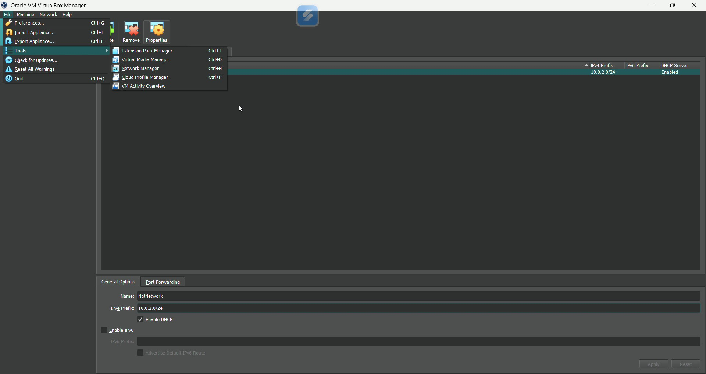
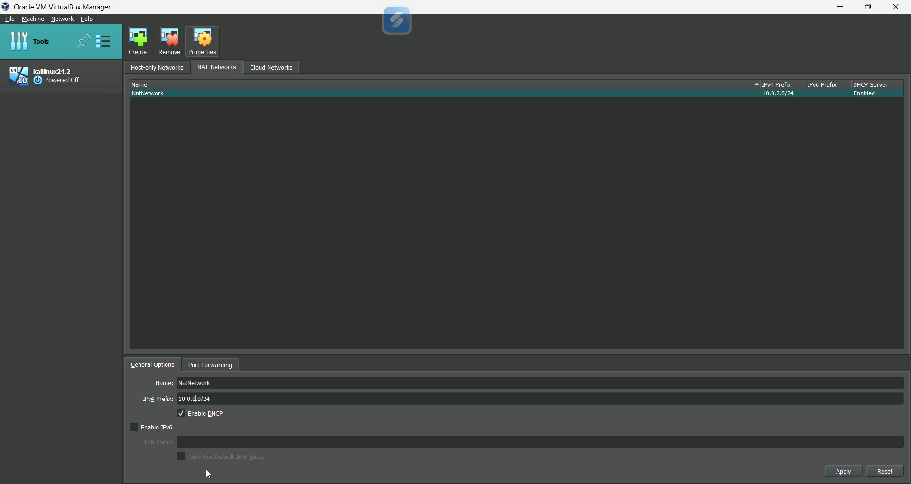
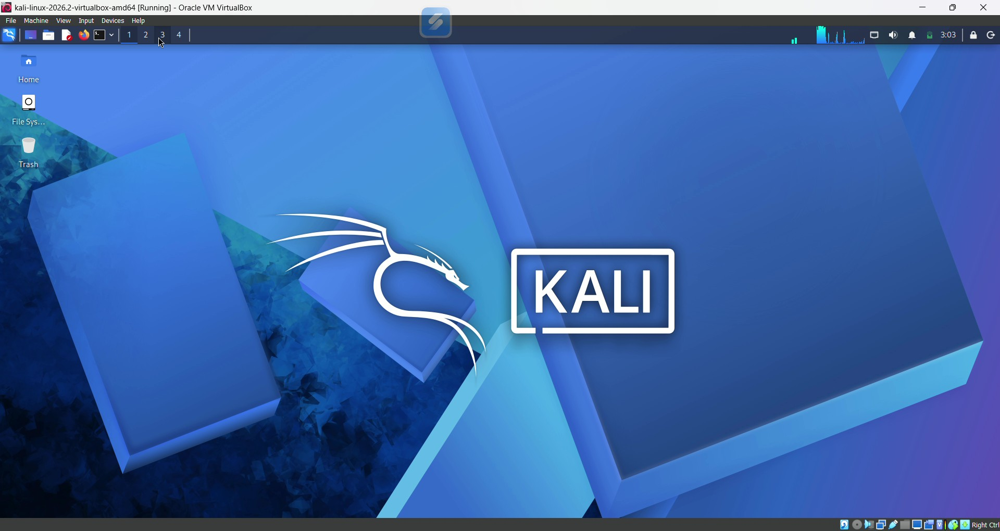
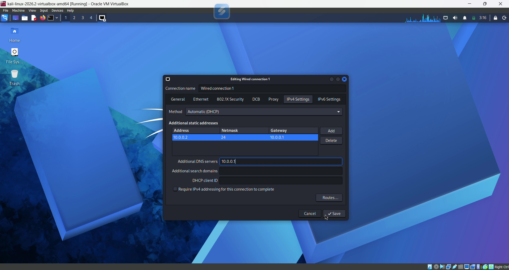
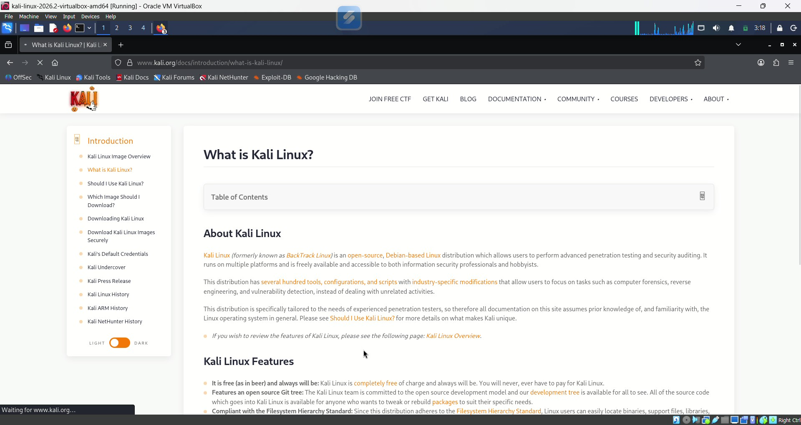
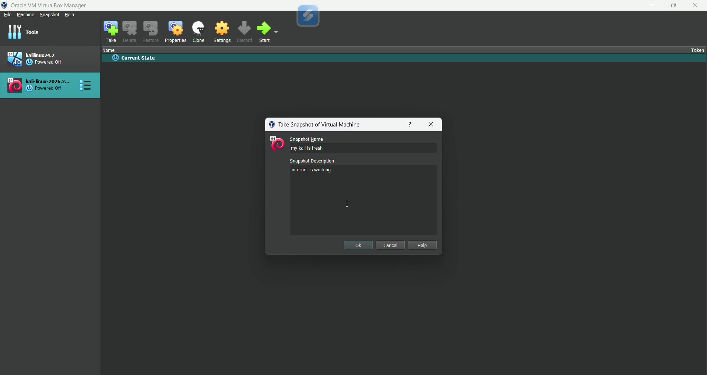

# 🔐 Cybersecurity Lab Environment Setup

**Building a virtual lab for cybersecurity learning, network analysis, and authorized ethical hacking practice.**

<p align="center">
  
</p>

---

## 📌 Project Overview

This project documents the setup of a cybersecurity lab using **Oracle VirtualBox** and **Kali Linux** as part of the Networkwalks WK1-PM1 practical assignment.

The project covers virtual machine setup, NAT Network configuration, Kali Linux network settings, internet connectivity testing, and snapshot creation.

## 🎯 Objectives

- Configure a NAT Network in VirtualBox.
- Install and start Kali Linux in a virtual machine.
- Configure the VM's network settings.
- Test internet connectivity.
- Create a virtual machine snapshot.
- Document the setup with screenshots.

## 🛡️ Purpose and Ethical Use

This environment is intended for cybersecurity education and authorized testing. Only test systems you own or have explicit permission to assess.

## 🏗️ Lab Architecture

```text
Host Computer
     |
Oracle VirtualBox
     |
NAT Network: NatNetwork
Network prefix: 10.0.0.0/24
     |
Kali Linux VM
Intended IP: 10.0.0.2/24
     |
Internet connectivity
```

## ⚙️ Lab Configuration

| Component | Configuration |
|---|---|
| Virtualization Platform | Oracle VirtualBox |
| Security Operating System | Kali Linux |
| NAT Network Name | `NatNetwork` |
| Network Prefix | `10.0.0.0/24` |
| Intended Kali IP | `10.0.0.2/24` |
| Internet Connectivity | Tested |
| VM Snapshot | Created |

> **Note:** Verify the actual IP address, gateway, DNS, and shared-folder settings inside Kali Linux before marking them as confirmed.

---

## 🪜 Lab Setup Procedure

### Step 1: Configure the VirtualBox NAT Network

A NAT Network named `NatNetwork` was configured in VirtualBox.

The lab network uses the `10.0.0.0/24` network prefix.



**Additional NAT Network Configuration**



### Step 2: Install Kali Linux

Kali Linux was installed as a virtual machine in Oracle VirtualBox.



### Step 3: Configure Kali Linux Networking

The Kali Linux VM network settings were configured through VirtualBox and Kali Linux network settings.



### Step 4: Test Internet Connectivity

Internet connectivity was tested by opening an external website from the Kali Linux virtual machine.



### Step 5: Create a Virtual Machine Snapshot

A VirtualBox snapshot was created to preserve the virtual machine's state for future recovery.



---

## 🔎 Lab Verification

The following commands can be used to verify the network configuration.

| Test | Command | Purpose |
|---|---|---|
| Check IP address | `ip addr` | Display assigned IP addresses |
| Check routing | `ip route` | Display routes and default gateway |
| Test gateway | `ping -c 4 10.0.0.1` | Test gateway connectivity |
| Test internet | `ping -c 4 8.8.8.8` | Test external IP connectivity |
| Test DNS | `nslookup networkwalks.com` | Check domain resolution |

These are suggested verification commands; not every test is necessarily shown in the screenshots.

## 🐞 Troubleshooting

If internet connectivity fails, first check the active NetworkManager connection:

```bash
nmcli connection show
```

For a connection named `Wired connection 1`, the lab instructions provide these commands:

```bash
sudo nmcli connection modify "Wired connection 1" ipv4.dad-timeout 0
sudo nmcli connection down "Wired connection 1"
sudo nmcli connection up "Wired connection 1"
```

Connection names may differ between systems.

## 💡 What I Learned

- Configuring NAT Networks in VirtualBox.
- Installing and running Kali Linux in a virtual machine.
- Understanding basic IP addressing and network configuration.
- Testing internet connectivity.
- Creating snapshots for virtual machine recovery.
- Documenting a cybersecurity lab with screenshots.

## 🔐 Security and Ethical Use

This lab is intended for educational purposes and authorized security testing only.

## 🔗 Tools and Resources

- [Oracle VirtualBox](https://www.virtualbox.org/)
- [Kali Linux Downloads](https://www.kali.org/get-kali/)
- [Kali Linux Documentation](https://www.kali.org/docs/)

## 🎥 Video Demonstration

[](https://www.youtube.com/watch?v=1r2KePtM3P8)

▶️ [Watch the complete lab setup on YouTube](https://www.youtube.com/watch?v=1r2KePtM3P8)

## 📂 Repository Structure

```text
NETWORKWALKS-B084-WK1-PM1-CYBERSECURITY-LAB-SETUP/
├── Title-image.png
├── 01-virtualbox-nat-network.jpg
├── 01.1-virtualbox-nat-network.jpg
├── 02-kali-installed.jpg
├── 03-kali-vm-network-settings.jpg
├── 04-kali-internet-test.jpg
├── 05-kali-vm-snapshot.jpg
└── README.md
```

## 👤 Author

**Devkrishna Nagda**  
B.Tech Computer Science and Engineering  
Cybersecurity Learner | CEH Certified

GitHub: [devkrishnanagda22](https://github.com/devkrishnanagda22)

## 📌 Project Information

| Field | Details |
|---|---|
| Program | Networkwalks |
| Assignment | WK1-PM1 |
| Project | Cybersecurity Lab Environment Setup |
| Focus | Virtualization, networking, and cybersecurity fundamentals |

---

<p align="center"><strong>Learn • Practice • Secure</strong></p>
